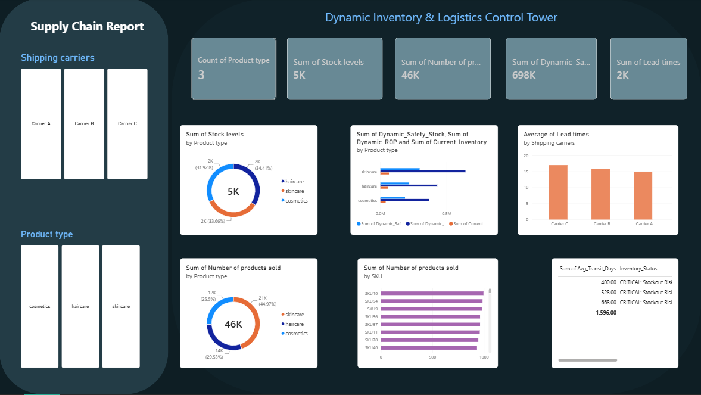

# Dynamic Supply Chain & Inventory Control Tower

An executive dark-themed Power BI dashboard designed for real-time inventory tracking, buffer health analysis, and logistics transit volatility monitoring.

## 📊 Dashboard Preview


## 📌 Project Overview
- **Domain:** Supply Chain, Operations & Logistics
- **Tools Used:** Power BI, DAX, Python / Excel
- **Dataset:** Inventory records including SKUs, lead times, buffer levels, and carrier transit metrics.

## 🎯 Key Features & Metrics
- **Top KPIs:** Monitored Categories, Total Stock Units, Demand, Dynamic Safety Stock, Average Transit Days (TIT).
- **Buffer Health Monitoring:** Comparative analysis of Current Inventory vs. Dynamic ROP vs. Safety Stock to mitigate stockouts.
- **Logistics Volatility:** Carrier-wise transit lead times to identify transport bottlenecks.
- **SKU Prioritization:** Identification of top fast-moving SKUs driving demand.

## 🛠️ How to View the Project
1. Clone the repository:
   ```bash
   git clone [https://github.com/your-username/repository-name.git](https://github.com/your-username/repository-name.git)
